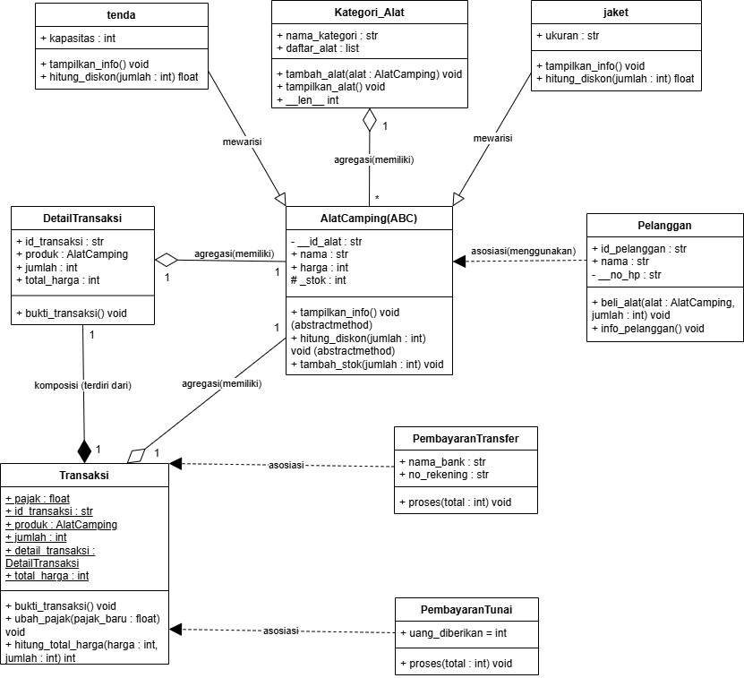
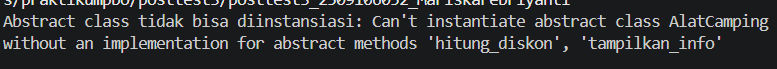

# Sistem Manajemen Penjualan Alat Camping
## Deskripsi Program
Program ini merupakan penerapan Pemrograman Berorientasi Objek (PBO) menggunakan Python untuk mengelola penjualan alat camping pada toko "Camping Yuk". Program menerapkan konsep class, object, encapsulation, property dan setter, class method, static method, inheritance, relasi UML, abstraksi (Abstract Base Class), dan polimorfisme (via pewarisan, duck typing, dan operator overloading).

## Penerapan Relasi UML



#### 1. Asosiasi (menggunakan)

#### Pelanggan -> AlatCamping

Pada program ini, asosiasi diterapkan antara class pelanggan dan class AlatCamping melalui method `beli_alat()`. Objek alat diterima sebagai parameter ketika pelanggan membeli produk. Objek alat tidak disimpan sebagai atribut milik pelanggan, sehingga keduanya tetap dapat berdiri sendiri.
```python
def beli_alat(self, alat, jumlah):
        if jumlah <= alat.stok:
            alat.stok -= jumlah
            print(f"{self.nama} berhasil membeli {jumlah} {alat.nama}. Stok sekarang: {alat.stok}")
        else:
            print(f"Stok {alat.nama} tidak cukup. Stok sekarang: {alat.stok}")
```

#### 2. Agregasi(memiliki)

Agregasi diterapkan pada class Kategori_Alat yang menampung objek AlatCamping ke dalam atribut daftar_alat. Objek alat dibuat terlebih dahulu di luar class kategori, kemudian dimasukkan menggunakan method `tambah_alat()`. Dengan demikian, objek alat tetap dapat digunakan meskipun objek kategori dihapus.
```python
def tambah_alat(self, alat):
    if isinstance(alat, AlatCamping):
        self.daftar_alat.append(alat)
    else:
        print("Hanya objek AlatCamping yang dapat ditambahkan")
```

#### 3. Komposisi (terdiri dari)

Komposisi diterapkan antara class Transaksi dan DetailTransaksi. Objek DetailTransaksi dibuat langsung di dalam constructor Transaksi dan disimpan pada atribut detail_transaksi. Hal ini menunjukkan bahwa detail transaksi menjadi bagian dari objek transaksi.
```python
self.detail_transaksi = DetailTransaksi(id_transaksi, produk, jumlah, total_harga)
```

## Penerapan Abstraksi (Abstract Base Class)
#### Abstract class: `AlatCamping(ABC)`
#### memiliki 2 abstract method:
`tampilkan_info()` dan `hitung_diskon()`

#### subclass yang mengimplementasikan seluruh abstract method: 
`tenda` dan `jaket`. Keduanya mengimplementasikan method `tampilkan_info()` dan `hitung_diskon()`

#### Method konkret yang dipakai bersama: 
`tambah_stok(jumlah)` di `AlatCamping`. 

#### Bukti abstract class tidak bisa diinstansiasi
```python
try:
    alat = AlatCamping("AL001", "Tenda 2 orang", 500000, 10)
except TypeError as e:
    print("Abstract class tidak bisa diinstansiasi:", e)
```
#### Output:


## Penerapan Polimorfisme
### Polimorfisme via pewarisan
Method `tampilkan_info()` dan `hitung_diskon()` di override oleh `tenda` dan `jaket` dengan perilaku berbeda:
`tenda` menampilkan kapasitas dan memberi diskon 10% untuk pembelian minimal 2.
`jaket` menampilkan ukuran dan memberi diskon 5% untuk pembelian minimal 3.
keduanya dipanggil lewat satu loop:
```python
daftar_produk = {produk1, produk2}
for alat in daftar_produk:
    alat.tampilkan_info()
```
### Duck Typing
`PembayaranTunai` dan `PembayaranTransfer` tidak berhubungan lewat pewarisan, tetapi sama-sama memiliki method `proses(total)`. Keduanya dipanggil lewat satu fungsi yang sama:
```python
def proses_pembayaran(metode, total):
    metode.proses(total)
```

### Operator overloading
Magic method `__len__` diterapkan pada `Kategori_Alat`, sehingga `len(kategori1)` mengembalikan jumlah alat di dalam kategori:
```python
def __len__(self):
    return len(self.daftar_alat)
```

## Penerapan Solid
#### 1. Single Responsibility Principle(SRP)
Pada program ini, SRP diterapkan pada class `Kategori_Alat`, `pelanggan`, `PembayaranTunai`, dan `PembayaranTransfer`. Class `Kategori_Alat` bertanggung jawab untuk mengelola kategori dan daftar alat, class `pelanggan` bertanggung jawab untuk mengelola informasi pelanggan dan proses pembelian alat, sedangkan class `PembayaranTunai` dan `PembayaranTransfer` bertanggung jawab untuk menangani proses pembayaran sesuai metode masing-masing. Pembagian tanggung jawab ini membuat setiap class memiliki fungsi utama yang berbeda sehingga program lebih terstruktur dan mudah dipahami.

#### 2. Open/Closed Principle(OCP)
Pada program ini, OCP diterapkan pada class `AlatCamping` sebagai superclass serta class `tenda` dan `jaket` sebagai subclass. Kedua subclass mengimplementasikan method `tampilkan_info()` dan `hitung_diskon()` sesuai karakteristik produknya. Dengan struktur ini, jenis alat camping baru dapat ditambahkan melalui subclass baru tanpa harus mengubah implementasi class tenda dan jaket yang sudah ada.

## Pengujian Program
### Pengujian Pada Class AlatCamping, Subclass(Tenda, jaket), Kategori_Alat
``` python
produk1 = tenda("AL001", "Tenda 2 orang", 500000, 10, 10)
produk2 = jaket("AL002", "Jaket Gunung", 150000, 15, "M")
```
pertama-tama saya membuat 2 objek yaitu tenda 2 orang dan sleeping bag.
```python
produk1.tampilkan_info()
produk2.tampilkan_info()
```
disini saya memanggil method tampilkan_info() untuk menampilkan informasi produk sesuai objek yang telah kita buat sebelumnya.
```python
produk1.tambah_stok(5)
```
melakukan penambahan stok sebanyak 5 kepada produk1.
```python
produk2.tambah_stok(-3)
```
melakukan pengujian penambahan stok bernilai negatif, disini akan menampilkan pesan error "Jumlah yang ditambahkan harus lebih dari 0" karena tidak boleh memasukkan stok kurang dari 0.
```python
kategori1 = Kategori_Alat("Tenda")
kategori2 = Kategori_Alat("Jaket")
```
membuat kategori yang terdiri kategori1 = Tenda dan kategori2 = Jaket
```python
kategori1.tambah_alat(produk1)
kategori2.tambah_alat(produk2)
```
menambahkan produk1(tenda) ke dalam kategori1 dan menambahkan produk2(jaket) ke dalam kategori2
```python
kategori1.tampilkan_alat()
kategori2.tampilkan_alat()
```
disini saya memanggil method tampilkan_alat() untuk menampilkan informasi kategori dan informasi produk yang telah kita buat sebelumnya.
```python
produk1.stok = 12
```
melakukan pengubahan stok menjadi 12 kepada produk1.
```pyhon
produk1.stok = -5
```
melakukan pengubahan stok menjadi -5, disini akan ditampilkan pesan error "Stok tidak boleh negatif" karena tidak boleh memasukkan stok kurang dari 0. 
```python
produk1.stok = "lima"
```
melakukan perubahan stok, disini akan ditampilkan pesan error "stok harus angka" karena disini kita memasukkan string("lima") sedangkan stok bertipe integer
### Pengujian Pada Class Pelanggan
```python
pelanggan1 = pelanggan("PL001", "Febri", "082251567811")
pelanggan2 = pelanggan("PL002", "Yanti", "08224153753")
```
membuat 2 objek pada class pelanggan. 
```python
pelanggan1.info_pelanggan()
pelanggan2.info_pelanggan()
```
disini saya memanggil method info_pelanggan() untuk menampilkan informasi pelanggan sesuai objek yang telah kita buat sebelumnya.
```python
pelanggan1.no_hp = "081365478"
```
melakukan pengubahan no_hp menjadi "081365478", disini akan di tampilkan pesan error "Nomor HP harus memiliki minimal 11 digit" karena nomor_hp yang di masukkan kurang dari 10.
```python
pelanggan2.no_hp = 124442790081
```
melakukan pengubahan no_hp menjadi 124442790081, disini akan di tampilkan pesan error "Nomor HP harus berupa string", karena tipe data no_hp harus string sedangkan kita memasukkan angka yg bertipe data integer
```python
pelanggan1.beli_alat(produk1, 3)
pelanggan2.beli_alat(produk2, 5)
```
memanggil method beli_alat() pada objek pelanggan1 dan pelanggan2 untuk membeli produk. pelanggan1 membeli 3 produk1 (tenda) dan pelanggan2 membeli 5 produk2 (jaket). Ini adalah penerapan asosiasi, karena objek alat dikirim lewat parameter method dan tidak disimpan di dalam class pelanggan. Stok alat otomatis berkurang, sehingga stok produk1 menjadi 9 (12 - 3) dan stok produk2 menjadi 10 (15 - 5).
### pengujian pada Class Transaksi
```python
Trans1 = Transaksi("TR01", produk1, 2, 1000000)
Trans2 = Transaksi("TR02", produk2, 1, 150000)
```
membuat 2 objek pada class pelanggan.
```python
Trans1.bukti_transaksi()
Trans2.bukti_transaksi()
```
disini saya memanggil method bukti_transaksi() untuk menampilkan bukti transaksi sesuai objek yang telah kita buat sebelumnya.
```python
print("pajak awal:", Transaksi.pajak)
Transaksi.ubah_pajak(0.15)
print("pajak baru:", Transaksi.pajak)
```
outpul awal akan menampilkan pajak awal 0.1 , pada perintah ubah_pajak berfungsi untuk mengubah pajak dalam class transaksi disini saya mengubah pajak menjadi 0.15, dan pada baris akhir berfungsi untuk menampilkan pajak setelah diubah.
```python
hitung_total = Transaksi.hitung_total_harga(produk1.harga, 3)
print(f"Total harga untuk 3 {produk1.nama}: {hitung_total}")
```
disini akan menampilkan total harga sesuai perhitungan yaitu harga * jumlah
### Pembayaran, Operator Overloading, dan Diskon
```python
proses_pembayaran(PembayaranTunai(1200000), Trans1.total_harga)
proses_pembayaran(PembayaranTransfer("BCA", "1234567890"), Trans2.total_harga)
```
Pembayaran tunai Rp1.200.000 untuk total Rp1.000.000 menghasilkan kembalian 200.000, sedangkan pembayaran transfer menampilkan instruksi transfer ke rekening BCA
```python
print(f"Jumlah alat di kategori {kategori1.nama_kategori}: {len(kategori1)}\n")
```
Memanggil `__len__` pada `Kategori_Alat`, hasilnya 1 karena kategori Tenda berisi baru satu alat
```python
print(f"Diskon 2 tenda : Rp{produk1.hitung_diskon(2):,.0f}")
print(f"Diskon 4 jaket : Rp{produk2.hitung_diskon(4):,.0f}") 
```
Diskon 2 tenda = 10% x 500000 x 2 = Rp100.000 dan diskon 4 jaket = 5% x 150000 x 4 = Rp30.0000